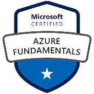
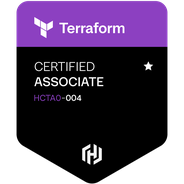

# Hi, I'm Mark Jones

  
  

**Azure Cloud & DevOps Engineer and Senior .NET Developer**, a UK contractor based in North Wales, working remotely across the UK.

I build and run secure Azure platforms, and the .NET services that run on them. Over 20 years in C#, .NET and SQL Server, most recently on UK public sector programmes (Defra and the Crown Prosecution Service).

- **SC cleared** (transferable, valid to Oct 2029) and **NPPV3** (to 2032)
- **DevOps Excellence Awards 2024: Best Public Sector Project** (CPS Casework App)
- **HashiCorp Certified: Terraform Associate (004)**, Nov 2026 ([verify](https://www.credly.com/badges/e22dfb80-a3e5-4e2c-8afb-f769ccd27231/public_url))
- **AZ-400** exam passed Nov 2026 · **AZ-104** booked · previously DevOps Engineer Expert and Azure Developer Associate (2025–26)

## Where to see my work

Much of my client work is in private repositories (for example Azure DevOps-hosted test suites). The links below are the **public portions** of programmes I've worked on, so you'll see my commits alongside those of my colleagues.

### Crown Prosecution Service: Casework App (Polaris), 2022–2025
**[CPS-Innovation/Polaris](https://github.com/CPS-Innovation/Polaris)**

A national case management system for prosecutors, taken from a stalled proof of concept through to national production. I was **sole owner of CI/CD and infrastructure**.

| Area | What to look at |
| --- | --- |
| Pipelines | Templated Azure DevOps YAML pipelines (I authored about 90% of pipeline changes), approval gates, blue/green deployment-slot releases |
| Infrastructure as Code | Terraform for VNets and subnets, private endpoints, Private DNS, DNS Private Resolver, Application Gateway + WAF, Entra ID app registrations, RBAC, Key Vault with customer-managed keys |
| Build agents | Self-hosted agents on VM Scale Sets inside the VNet, with a custom Ubuntu image rebuilt weekly with Packer |
| Application | .NET 8 isolated Durable Functions document pipeline (Aspose PDF conversion, Azure AI Vision OCR, Azure AI Search), health checks, a sliding-window data-retention clear-down |
| Security | CodeQL and Checkov scanning via GitHub Actions |

**C# highlights:** pull requests where I wrote the application code (my commits appear as *Mark Jones* or *aceltuk*):

| Pull request | What it does |
| --- | --- |
| [#160](https://github.com/CPS-Innovation/Polaris/pull/160), [#208](https://github.com/CPS-Innovation/Polaris/pull/208) | Automated case clear-down: removes search index entries, blobs and Durable Functions orchestration history for inactive cases |
| [#744](https://github.com/CPS-Innovation/Polaris/pull/744) | Batch processing for the sliding-window case clear-down |
| [#204](https://github.com/CPS-Innovation/Polaris/pull/204) | Purge API |
| [#787](https://github.com/CPS-Innovation/Polaris/pull/787) | PDF Generator moved to the .NET 8 isolated worker, to unblock Aspose library upgrades |
| [#864](https://github.com/CPS-Innovation/Polaris/pull/864) | Controlled error handling during PDF conversion |
| [#1200](https://github.com/CPS-Innovation/Polaris/pull/1200) | Health-check endpoint for the PDF Generator, wired into Terraform |
| [#1382](https://github.com/CPS-Innovation/Polaris/pull/1382) | Text Extractor upgraded to .NET 8 |
| [#1482](https://github.com/CPS-Innovation/Polaris/pull/1482) | New PDF Thumbnail Generator service (Durable Functions) |
| [#1500](https://github.com/CPS-Innovation/Polaris/pull/1500) | Fix for OAuth security exceptions in the gateway |
| [#1550](https://github.com/CPS-Innovation/Polaris/pull/1550) | Correct isolated `DurableTaskClient` implementation |

### Defra: Extended Producer Responsibility for packaging (EPR), 2025–2026
About **230 commits across 26 public [DEFRA](https://github.com/DEFRA) EPR repositories**, on a .NET 10 / C# 14 microservice estate on Azure. Some of the more heavily contributed include:

| Repository | My work |
| --- | --- |
| [epr-pom-api-submission-status](https://github.com/DEFRA/epr-pom-api-submission-status) | Backend API: MediatR CQRS command and query handlers, FluentValidation, Cosmos DB; resubmission-cycle status tracking |
| [epr-packaging-frontend](https://github.com/DEFRA/epr-packaging-frontend) | ASP.NET Core MVC journeys, English/Welsh content on GOV.UK Frontend |
| [epr-pom-func-producer-validation](https://github.com/DEFRA/epr-pom-func-producer-validation) | Recyclability (RAM-RAG) and closed-loop recycling validation rules |
| [epr-backend-account-microservice](https://github.com/DEFRA/epr-backend-account-microservice) | Backend microservice work, including the .NET 10 upgrade |
| [epr-pom-api-web](https://github.com/DEFRA/epr-pom-api-web) | API gateway |

Across the estate I upgraded **19 repositories to .NET 10 LTS and C# 14** (moving Function Apps to the isolated worker model), fixed NuGet vulnerability advisories, hardened Docker images, and met SonarQube quality gates with 90%+ test coverage.

---

## Toolbox

**Cloud & platform:** Azure (App Service, Functions, Durable Functions, Service Bus, Cosmos DB, Azure SQL, Key Vault, Application Gateway, Private Link, Entra ID, API Management, Logic Apps, Monitor / Log Analytics / Application Insights), plus AWS (Lambda, SNS/SQS, IAM)

**DevOps & IaC:** Azure DevOps YAML pipelines, GitHub Actions, Terraform, Bicep/ARM, Packer, Docker, Kubernetes and Helm (on AWS), PowerShell, Bash, Python

**Development:** C#, .NET 10 / .NET Core, ASP.NET Core (MVC and Web API), EF Core, Dapper, MediatR, SQL Server / T-SQL, Cosmos DB, MongoDB, React/TypeScript (working knowledge)

**Quality & security:** TDD and BDD (xUnit, NUnit, MSTest, SpecFlow, Playwright), Testcontainers, WireMock, SonarQube, CodeQL, Checkov, OWASP Dependency-Check

**AI-assisted engineering:** Claude Code in my own workflow: code and data investigation, scaffolding, help with large pull requests, and spike work (for example, investigating whether reliable migration identifiers existed in Defra's registration and packaging data)

---

## Earlier highlights

- **Cheshire West and Chester / Cheshire East councils (2012–2021):** integration services and messaging behind online citizen services (GovPay, Dynamics CRM/365, SharePoint, Lagan, Northgate, Bartec). Migrated them to Azure, and built an API Management gateway between the Firmstep forms platform and around 100 Logic Apps. KANA Award 2014 for an innovative solution.
- **Shelby Finance (2021–2022):** .NET microservices on AWS for a regulated consumer lender, including a Payments API with Worldpay integration.

---

**Get in touch:** [LinkedIn](https://www.linkedin.com/in/mark-jones-613a35248)
